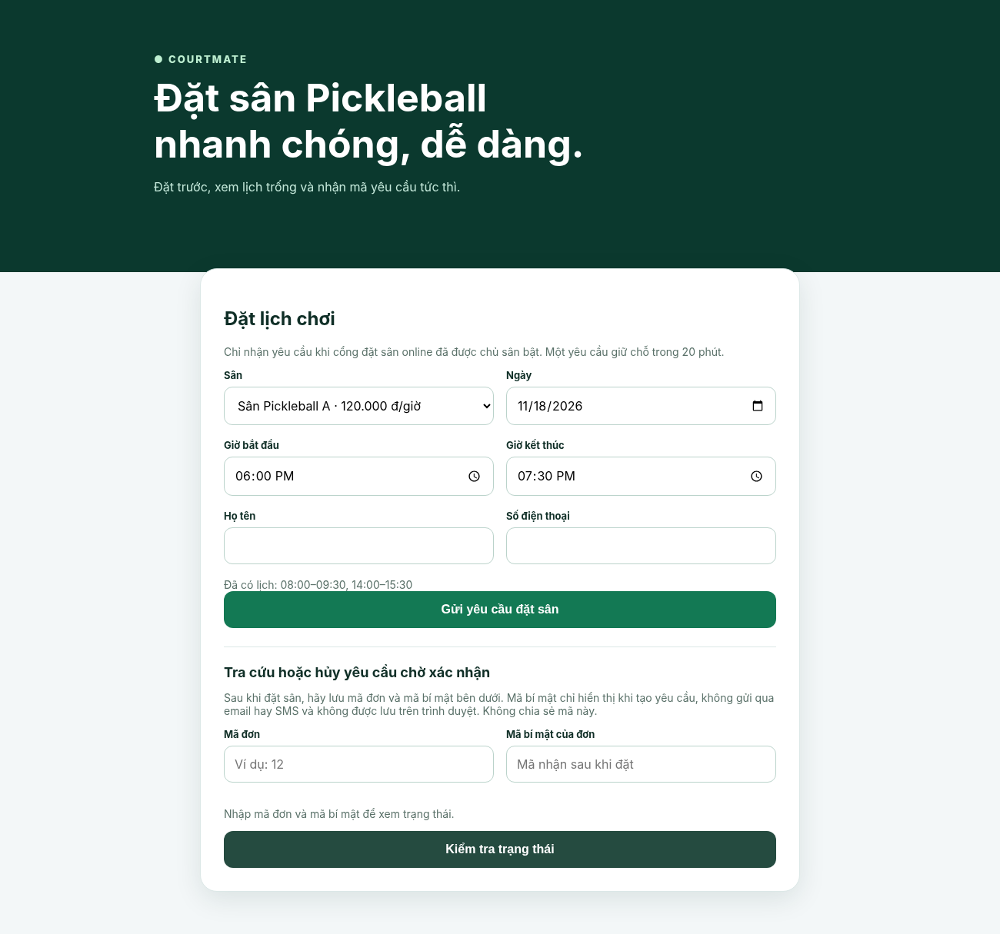

# CourtMate — Quản lý sân Pickleball

**Android (Java/XML/SQLite) · Python/FastAPI · Demo website · v2.3 (nhánh phát triển)**

[](https://github.com/nguyenhonggiang2407/CourtMate/actions/workflows/ci.yml?query=branch%3Aupgrade%2Fv2.3) · [Demo tương tác](demo/index.html) · [Tài liệu triển khai](docs/DEPLOY_DEMO.md) · [Kiểm thử Android](docs/QA_ANDROID.md)

CourtMate là đồ án/portfolio xây dựng quy trình quản lý sân Pickleball từ đặt lịch đến nhận sân, dịch vụ, cọc, hóa đơn và báo cáo. Phần Android hỗ trợ vận hành tại sân với SQLite cục bộ; phần FastAPI là **lịch cloud riêng** cho website đặt trước và các máy quản lý truy cập online.

> **Đây là bản demo kỹ thuật, không phải hệ thống sẵn sàng kinh doanh.** Lịch Android và cloud chưa đồng bộ; không được nhận đặt cho cùng sân qua hai nguồn đồng thời. Chưa tích hợp ngân hàng thật. Không dùng dữ liệu cá nhân hoặc giao dịch thật trên bản demo.



## Xem demo trong 30 giây

- **Không cần cài đặt:** tải file [demo/index.html](demo/index.html) bằng nút Raw/Download rồi mở bằng Chrome hoặc Edge. Đây là bản **mô phỏng độc lập**, không gọi server, không xử lý thanh toán thật.
- **Muốn host online:** có cấu hình `render.yaml` cho **Render Static Site** (không có backend). Xem [hướng dẫn triển khai](docs/DEPLOY_DEMO.md). Chưa có link live được xác nhận.
- **Muốn kiểm thử API thật:** chạy FastAPI localhost theo hướng dẫn bên dưới, tạo 4 sân demo bằng `scripts/seed_demo.py` hoặc tạo sân bằng API, rồi truy cập `/`.

## Chức năng

| Android (SQLite, offline) | Website / Cloud pilot (FastAPI) |
| --- | --- |
| Admin/Staff, phân quyền trong ứng dụng | API tạo và duyệt yêu cầu đặt sân |
| Quản lý sân, khách, lịch chơi, timeline | Xem sân và các khung giờ đã giữ |
| Phiên chơi, dịch vụ, thuê thiết bị | Chặn đặt trùng bằng transaction SQLite |
| Cọc, thu tiền nội bộ, hóa đơn | Giữ chỗ 20 phút; tra cứu và hủy khi còn chờ |
| HLV, lớp, giải đấu, sự kiện, thống kê | Quản lý đóng/mở sân và tổng hợp lịch cloud |
| Sao lưu/khôi phục dữ liệu offline | Adapter webhook có ký HMAC (chưa kết nối PSP thật) |

## Kiến trúc

```text
Điện thoại Android (Java/XML)
  ├── Activity / một phần ViewModel + Repository
  ├── SQLite cục bộ (lịch và hóa đơn offline)
  └── CloudBookingRepository ─────┐
                                    │ HTTPS / token quản trị thí điểm
Trình duyệt website ─── HTTPS ─────┤
                                    ▼
                           FastAPI (backend/app.py)
                                    │
                           SQLite cloud riêng
```

**Điểm cần phát triển tiếp:** xác thực nhân viên cloud theo tài khoản, backend làm nguồn lịch chính, chiến lược đồng bộ và chống xung đột, kiểm thử UI thực tế.

### Tối ưu Cloud 2.3.1 (nhánh `optimize/v2.3.1`)

Bản nâng cấp này sửa lỗi xác nhận giữ chỗ quá hạn; giới hạn bộ nhớ của rate limiter; thêm chỉ mục SQLite; hỗ trợ phân trang danh sách lịch quản trị và kiểm tra ngày xem lịch trống giống ngày tạo lịch. API mặc định giữ nguyên để tương thích ứng dụng Android 2.3. Bộ kiểm thử backend tăng từ **16 lên 21 bài**. Xem [báo cáo tối ưu và giới hạn](docs/OPTIMIZATION_2_3_1.md).


## Chạy Android

1. Mở thư mục gốc (có `settings.gradle.kts`) bằng Android Studio.
2. Cài Android SDK API 37.0, mở Gradle Sync; dự án dùng Java 25, Gradle 9.6 và AGP 9.4.1.
3. Chạy thiết bị Android (minSdk 24) hoặc emulator; lần đầu tự tạo Admin, **không có tài khoản mặc định**.
4. Lệnh build:

```bash
bash ./gradlew --no-daemon testDebugUnitTest assembleDebug
# APK debug: app/build/outputs/apk/debug/app-debug.apk
```

Có thể tải APK debug ở artifact của GitHub Actions **nếu job Android xanh**; APK chưa phải bản phát hành ký chính thức. Xem [checklist thử trên điện thoại](docs/QA_ANDROID.md).

## Chạy API/website thật trên máy cá nhân

Yêu cầu Python 3.11+:

```bash
python -m pip install -r backend/requirements-dev.txt
# macOS/Linux — không commit token này:
export COURTMATE_ADMIN_TOKEN="$(python -c 'import secrets; print(secrets.token_urlsafe(48))')"
export COURTMATE_PUBLIC_BOOKING=true
cd backend
python -m uvicorn app:app --host 127.0.0.1 --port 8000
```

Trên Windows PowerShell, thay `export` bằng `$env:COURTMATE_ADMIN_TOKEN = ...` và `$env:COURTMATE_PUBLIC_BOOKING = "true"`.

Mở `http://127.0.0.1:8000/docs` để tạo sân/duyệt lịch bằng header `Authorization: Bearer <token>`, hoặc mở `http://127.0.0.1:8000/` để đặt lịch với API. Không có sân nếu chưa tạo/nạp dữ liệu mẫu.

```bash
# Test từ thư mục backend:
python -m pytest tests -q
# Trở về thư mục gốc:
python scripts/smoke_http.py
```

HTTP smoke script khởi chạy Uvicorn trên cổng localhost ngẫu nhiên, tạo SQLite tạm, gửi HTTP thật để kiểm chứng kiểm soát truy cập, tạo sân, đặt trùng, tra cứu/hủy và trả slot.

## Chất lượng, bảo mật, giới hạn

- **CI**: GitHub Actions chạy backend test + HTTP smoke test, Android unit tests + `assembleDebug`, upload APK debug khi build thành công.
- **Bảo mật**: không commit `.env`, database, API key, keystore; token dùng chung chỉ dành cho pilot; không có ngân hàng thật. Xem [SECURITY.md](SECURITY.md).
- **Triển khai**: demo tĩnh có thể host miễn phí; FastAPI cần HTTPS và lưu trữ bền vững. Render Free có filesystem tạm, không phù hợp giữ lịch thật.
- **QA**: build APK không chứng minh UI đã hoạt động. Trước khi trình diễn cần thử emulator/thiết bị với [checklist](docs/QA_ANDROID.md).
- **Giấy phép**: hiện chưa có `LICENSE`; liên hệ chủ repo để xin phép trước khi tái sử dụng nguồn.

## Lộ trình

1. **2.3**: CI Android, APK debug, smoke test HTTP, chuẩn hóa README/demo, cấu hình deploy static.
2. **2.5**: một nguồn lịch chuẩn trên cloud, đồng bộ Android, phân quyền per-staff và bộ kiểm thử xung đột đa thiết bị.
3. **3.0**: PostgreSQL, thông báo, đối soát và refund, báo cáo quản trị, bảo mật và kiểm thử production.

Tài liệu: [Release 2.3](docs/RELEASE_2_3.md) · [Demo Script](docs/DEMO_SCRIPT.md) · [API backend](backend/README.md) · [Changelog](CHANGELOG.md).
